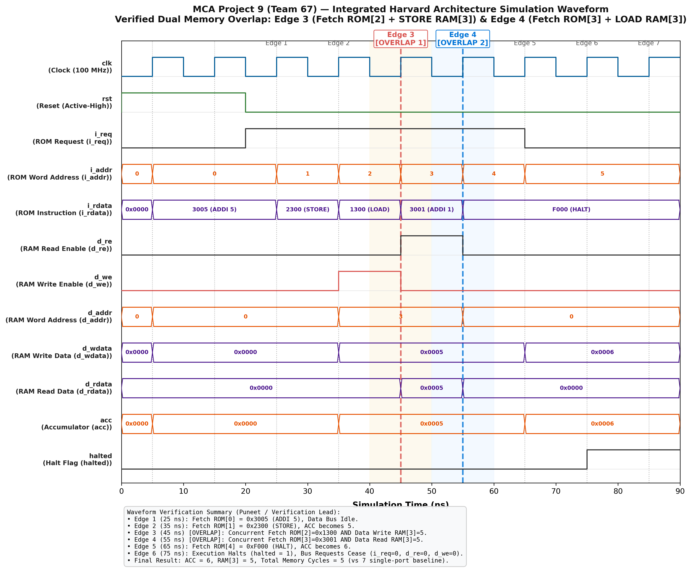

# Verification and Waveform Evidence

**Owner:** Puneet (Verification Lead)  
**Project:** MCA Project 9 — Instruction and Data Memory Hierarchy (Phase I)  
**Deliverables:** Integrated Testbench (`tb/harvard_tb.v`), Directed LOAD Testbench (`tb/directed_load_tb.v`), Automated Simulation Runner (`scripts/sim.sh`), Waveform Generator (`scripts/generate_waveform.py`), and Simulation Evidence.

---

## 1. Executive Summary

The verification suite verifies the Harvard memory hierarchy prototype implemented in synthesizable Verilog. The testbenches prove that:
1. The controller and memories correctly execute the 5-word demo program to completion (`ACC = 6`, `RAM[3] = 5`, `halted = 1`).
2. The independent instruction ROM and data RAM buses support **simultaneous, concurrent access** on the same clock edges:
   - **Edge 3:** Instruction Fetch (`ROM[2] = 0x1300`) concurrent with Data Write (`STORE 5` to `RAM[3]`).
   - **Edge 4:** Instruction Fetch (`ROM[3] = 0x3001`) concurrent with Data Read (`LOAD 5` from `RAM[3]`).
3. Execution halts cleanly on Edge 6, and all memory request lines (`i_req`, `d_re`, `d_we`) remain suppressed in post-halt quiescence (Edge 7).
4. The directed LOAD testbench proves that the LOAD instruction genuinely reads data memory into the accumulator by setting ACC to 7 before LOAD and asserting that LOAD restores ACC to 5.

All 7 cycle-accurate assertions pass with zero warnings under Icarus Verilog (`iverilog -g2012 -Wall`).

---

## 2. Cycle-by-Cycle Verification Trace

The table below records the exact cycle-accurate signals sampled before and after each clock edge, starting from the first rising edge after reset release.

| Edge | Pre-Edge Request Controls | Pre-Edge Addresses & Data | Post-Edge Registers | Verification Description |
| :---: | :--- | :--- | :--- | :--- |
| **Reset** | `i_req=0, d_re=0, d_we=0` | Requests suppressed | `PC=0, IR=0, ACC=0, halted=0` | Synchronous reset holds all state cleared. |
| **1** | `i_req=1, d_re=0, d_we=0` | `i_addr=0, i_rdata=0x3005` | `IR=0x3005, PC=1, ACC=0` | Fetch `ROM[0]` (`ADDI 5`). IR loaded. |
| **2** | `i_req=1, d_re=0, d_we=0` | `i_addr=1, i_rdata=0x2300` | `IR=0x2300, PC=2, ACC=5` | Fetch `ROM[1]`. `ADDI 5` executes (`ACC = 5`). |
| **3** | **`i_req=1, d_we=1, d_re=0`** | **`i_addr=2, d_addr=3, d_wdata=5`** | **`RAM[3]=5, IR=0x1300, PC=3`** | **OVERLAP 1:** Fetch `ROM[2]` + Data STORE (`RAM[3] = 5`). |
| **4** | **`i_req=1, d_re=1, d_we=0`** | **`i_addr=3, d_addr=3, d_rdata=5`** | **`ACC=5, IR=0x3001, PC=4`** | **OVERLAP 2:** Fetch `ROM[3]` + Data LOAD (`ACC = 5`). |
| **5** | `i_req=1, d_re=0, d_we=0` | `i_addr=4, i_rdata=0xF000` | `IR=0xF000, PC=5, ACC=6` | Fetch `ROM[4]`. `ADDI 1` executes (`ACC = 6`). |
| **6** | `i_req=0, d_re=0, d_we=0` | Fetch suppressed by HALT opcode | `halted=1, PC=5, ACC=6` | Execution halts. Requests transition to idle. |
| **7** | `i_req=0, d_re=0, d_we=0` | Idle | `halted=1, ACC=6` | Post-halt quiescence. State holds steady. |

### Summary of Counts:
- **Instruction Fetches:** 5 (`ROM[0]` through `ROM[4]`)
- **Data Memory Operations:** 2 (1 STORE at Edge 3, 1 LOAD at Edge 4)
- **Total Memory Transfers:** 7
- **Harvard Memory-Service Cycles:** 5
- **Single-Port Serialized Cycles:** 7 (requires 2 extra cycles due to serializing Edges 3 & 4)

---

## 3. Waveform Evidence

The annotated waveform diagram below captures all 12 key architecture signals across the 7 post-reset clock edges, highlighting the dual-memory overlap points on Edges 3 and 4:



*Raw simulation waveform file:* `build/harvard.vcd`

### Key Signals Displayed:
1. `clk` — 100 MHz Simulation Clock (10 ns period)
2. `rst` — Synchronous Active-High Reset
3. `i_req` — Instruction ROM fetch request flag
4. `i_addr[3:0]` — Instruction word address (PC)
5. `i_rdata[15:0]` — Instruction word returned from ROM
6. `d_re` — Data RAM read enable
7. `d_we` — Data RAM write enable
8. `d_addr[3:0]` — Data RAM word address
9. `d_wdata[15:0]` — Data RAM write data from ACC
10. `d_rdata[15:0]` — Data RAM read data to ACC
11. `acc[15:0]` — Working Accumulator register
12. `halted` — Execution completion flag

---

## 4. Directed LOAD Test (`tb/directed_load_tb.v`)

### Problem Addressed:
In the course demo program, ACC already equals `5` prior to the `LOAD` instruction due to the preceding `ADDI 5`. Consequently, a bug where `LOAD` failed to update ACC would remain undetected by merely checking the final accumulator value.

### Directed Test Architecture:
The directed testbench introduces an intermediate modifying instruction (`ADDI 2`) between `STORE` and `LOAD`:
1. `ROM[0] = 0x3005` (ADDI 5) &rarr; `ACC = 5`
2. `ROM[1] = 0x2300` (STORE)  &rarr; `RAM[3] = 5`
3. `ROM[2] = 0x3002` (ADDI 2) &rarr; `ACC = 7` *(deliberately changes ACC away from 5!)*
4. `ROM[3] = 0x1300` (LOAD)   &rarr; Asserts that ACC is overwritten from `7` back to `5`.
5. `ROM[4] = 0xF000` (HALT)

### Result:
The directed test explicitly asserts `ACC === 7` prior to LOAD and `ACC === 5` immediately following LOAD. This confirms beyond doubt that the data memory read path and ACC latching are operating correctly.

---

## 5. How to Reproduce

From the repository root on macOS, Linux, or WSL:

```bash
# 1. Run all simulations (Integrated, Directed LOAD, and Isolated Memory)
./scripts/sim.sh

# 2. Re-generate high-resolution waveform artifacts
python3 scripts/generate_waveform.py

# 3. (Optional) Inspect waveforms interactively with GTKWave
gtkwave build/harvard.vcd
```

Complete logged terminal output is archived in [`simulation_pass.log`](simulation_pass.log).
